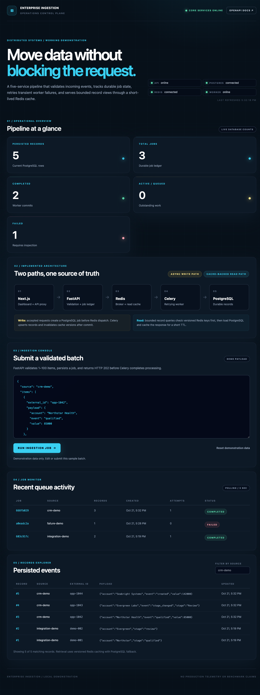
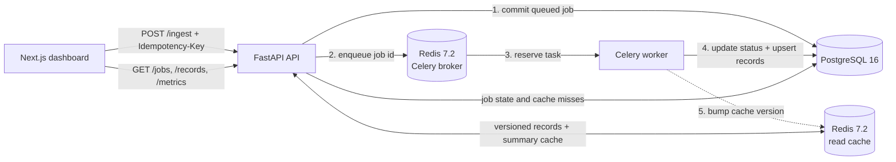

# Enterprise Ingestion & Retrieval Pipeline

An **AI-assisted, locally runnable reference application** demonstrating asynchronous data ingestion with Next.js, FastAPI, PostgreSQL, Redis, Celery, and Docker. Built to make architectural trade-offs inspectable in a technical interview or solutions engineering demonstration—not to represent a production-ready enterprise platform.

## Business Problem Solved

Enterprise teams often need to accept bursty partner, CRM, or operational data without holding an HTTP request open while every record is written. A synchronous path couples client latency to database work, encourages unsafe retries, and makes it difficult for operators to see what happened after a request was accepted.

This project demonstrates a safer boundary:

- **Platform operators** get durable job states, dependency health, retry visibility, and explicit failures.
- **Integration developers** get strict request validation, idempotent submission, meaningful HTTP responses, and OpenAPI documentation.
- **Business and data users** get a responsive record explorer without placing every repeated read directly on PostgreSQL.

The potential ROI is architectural rather than a fabricated benchmark: fewer duplicate writes, faster incident diagnosis, and independent scaling of the HTTP and processing tiers. This repository does **not** claim a throughput, latency, cost-savings, or cache-hit target. Those outcomes require workload-specific load tests and production telemetry.

## What the application does

- Accepts validated JSON batches and returns a job ID for asynchronous tracking.
- Processes batches in a dedicated Celery worker and persists records and job status in PostgreSQL.
- Detects idempotency-key conflicts and prevents duplicate record creation during retries.
- Provides a dashboard with dependency health, recent jobs, an ingestion console, and a bounded records explorer.
- Uses Redis for the task broker and short-lived read caches, with explicit failure and staleness boundaries.

## Dashboard



Actual local application capture using synthetic demonstration data, not customer data or production telemetry. The capture predates the remediation's refined health/staleness labels; current behavior is covered by the regression tests.

## Architecture and technology stack

### System invariants

- A job is committed to PostgreSQL before dispatch is attempted.
- A fresh submission returns `202 Accepted` after dispatch. If publishing fails, only a still-queued job can be cancelled with `503`; processing/completed work is preserved because delivery may already have happened.
- Reusing an idempotency key with the same canonical request returns the original job: `202` for outstanding work, `200` for completed work, and `503` for failed work. Different data returns `409 Conflict`. Failed jobs require a new key for an intentional new submission.
- A PostgreSQL session advisory lock serializes each job across status and record commits. Duplicate deliveries re-read state under the lock and skip terminal jobs. Record upserts prevent duplicate rows on retries.
- Job states are limited to `queued`, `processing`, `completed`, and `failed`.
- Record and metrics cache invalidation is attempted after a committed ingestion. If invalidation fails, existing cached responses can remain stale until their TTL (20 seconds by default). Redis read failures fall back to PostgreSQL.
- API record reads are bounded to 100 rows per request.



The write path is asynchronous after the durable job is created. The read path uses Redis only as an optimization: PostgreSQL remains the source of truth.

| Component | Responsibility |
|---|---|
| Next.js 16, React 19, TypeScript, Tailwind | Responsive dashboard, ingestion console, polling, job table, record explorer, and architecture view |
| FastAPI, Pydantic v2 | Validation, REST API, OpenAPI, CORS, dependency health, and error contracts |
| Celery | Background execution, bounded processing retries, continuing terminal-state recovery, and late acknowledgements |
| Redis 7.2 | Celery broker/result backend plus short-lived, versioned read caches |
| PostgreSQL 16, SQLAlchemy, Alembic | Durable jobs and records, uniqueness constraints, indexes, and schema migrations |
| Docker Compose | Local networking, health checks, persistent volumes, and five-service orchestration |

> The requested scaffold specified Next.js 14. It was upgraded to Next.js 16 because the latest 14.x release still produced critical production dependency advisories during implementation. The application still uses the requested App Router and TypeScript architecture.

## Example: a partner account batch

1. An integration developer submits two synthetic accounts with one idempotency key. FastAPI validates the request, commits a queued job, and publishes its ID to Redis before returning `202 Accepted`.
2. Celery reserves the task, serializes execution of that job, and marks it processing. Record upserts and the completed state commit together in PostgreSQL.
3. The worker attempts cache invalidation. The dashboard polls the durable job state and retrieves the stored accounts through the cache-backed API.
4. Repeating the same request/key retrieves the original job rather than scheduling another batch; changing the data under that key returns `409 Conflict`.

This demonstrates the customer-facing conversation around decoupling intake from processing, making retries safer, and explaining operational failure boundaries. It does not establish measured ROI or delivery guarantees.

## Local setup and demonstration

Requirements: Docker with Compose v2 and free ports 3000 and 8000.

```bash
git clone https://github.com/jlstacks/enterprise-ingestion-fastapi-nextjs.git && \
cd enterprise-ingestion-fastapi-nextjs && \
cp .env.example .env && \
docker compose up --build --wait
```

That is the copy-paste development spin-up. Before any shared or exposed deployment, replace both example passwords in `.env` with generated secrets.

- Dashboard: <http://localhost:3000>
- OpenAPI UI: <http://localhost:8000/docs>
- Health: <http://localhost:8000/health>

Stop the stack without deleting persisted data:

```bash
docker compose down
```

Delete local PostgreSQL and Redis volumes only when you intentionally want a clean database:

```bash
docker compose down --volumes
```

### Environment variables

| Variable | Purpose | Example |
|---|---|---|
| `POSTGRES_USER` | Local database role | `ingestion` |
| `POSTGRES_PASSWORD` | PostgreSQL password; change outside disposable local use | `generated-secret` |
| `POSTGRES_DB` | Database name | `ingestion` |
| `REDIS_PASSWORD` | Redis authentication; change outside disposable local use | `generated-secret` |
| `CACHE_TTL_SECONDS` | Metrics and records cache lifetime | `20` |
| `API_PORT` | Loopback host port for FastAPI | `8000` |
| `FRONTEND_PORT` | Loopback host port for Next.js | `3000` |

Inside Compose, `DATABASE_URL`, `REDIS_URL`, `ALLOWED_ORIGINS`, and `API_INTERNAL_URL` are assembled from these values. PostgreSQL and Redis are not published to the host.

## API

| Method | Endpoint | Behavior |
|---|---|---|
| `GET` | `/health` | Reports API, database, Redis, and worker health |
| `POST` | `/ingest` | Fresh dispatched jobs return 202; replays return 200/202/503 by state, conflicts 409 |
| `GET` | `/jobs?limit=10` | Lists recent jobs |
| `GET` | `/jobs/{job_id}` | Returns one durable job state |
| `GET` | `/records?limit=12&offset=0&source=demo-crm` | Returns bounded, optionally source-filtered records |
| `GET` | `/metrics` | Returns database counts by job state, cached for the configured TTL |

Submit a demonstration batch:

```bash
curl -i http://localhost:8000/ingest \
  -H 'Content-Type: application/json' \
  -H 'Idempotency-Key: demo-crm-batch-001' \
  --data '{
    "source": "demo-crm",
    "items": [
      {"external_id": "acct-001", "payload": {"account": "Northstar", "stage": "qualified"}},
      {"external_id": "acct-002", "payload": {"account": "Evergreen", "stage": "review"}}
    ]
  }'
```

Then poll the returned job and retrieve the records:

```bash
curl http://localhost:8000/jobs/JOB_ID
curl 'http://localhost:8000/records?source=demo-crm&limit=20'
```

Requests contain at most 100 items. `source` is 1–80 ASCII letters/digits/dot/underscore/hyphen, starting with a letter or digit. `external_id` is optional, 1–128 characters when supplied, and rejects control characters (including NUL) and invalid Unicode surrogates. Extra fields are rejected. Transient database failures return sanitized JSON `503` responses.

### Failure recovery and ordering

Processing has an initial attempt and up to three transient database retries.
After that budget is exhausted, deliveries perform **terminal-state persistence
only**: they do not restart record processing. If PostgreSQL remains unavailable,
Celery keeps scheduling recovery with a backoff capped at 30 seconds until it can
persist `failed` (or observe an already-terminal job). Permanent processing errors
use the same durable failure path. If publishing a retry fails, the original
delivery is rejected with requeue rather than acknowledged as completed.

Recovery requires the Redis broker's queued/unacknowledged messages to survive,
and PostgreSQL and a worker to become available again. It does not guarantee
delivery across broker data loss. Graceful worker shutdown restores reserved
deliveries; forced worker loss may delay redelivery until Redis's visibility
timeout (Celery's default is one hour). PostgreSQL is the authority for job status;
the Celery result can be successful when its recovery bookkeeping has correctly
persisted a failed application job. The separate processing status commit makes
`processing` observable; record writes and `completed` commit atomically while
the per-job lock remains held. A worker/process disconnect releases that lock.

Serialization protects **duplicate execution of the same job**. Distinct jobs
updating the same `(source, external_id)` follow commit order; no source event-time
ordering or monotonic version contract is implemented.

## Development and testing

Backend tests and static checks run in the repository's Python 3.12 test image:

```bash
docker build --target test -t enterprise-ingestion-backend-test ./backend
docker run --rm enterprise-ingestion-backend-test pytest -q tests
docker run --rm enterprise-ingestion-backend-test ruff check --no-cache app tests migrations
docker run --rm enterprise-ingestion-backend-test pip check
docker run --rm enterprise-ingestion-backend-test python security_audit.py python
```

Frontend checks:

```bash
cd frontend
npm ci
npm audit --omit=dev
npm run lint
npm run typecheck
npm run build
npm test
```

Running-stack integration check:

```bash
python3 backend/tests/integration_check.py
```

Every integration run generates a new source and key, requires an online worker,
and verifies a new job's attempts, completion, persisted content, cache hit, and
record upserts/cache invalidation. It intentionally fails without a worker.

CI builds the five-service stack, applies migrations, runs PostgreSQL/Redis
regressions, executes the fresh integration check, stops the worker to verify the
negative case, exhausts actual Celery retries using an unavailable database,
restores a normal worker and checks durable failure recovery, then restarts the
stack and verifies persistence. It also runs frontend health/error tests, lint,
type checking, production builds, backend tests/Ruff, dependency compatibility,
security audits, and Compose configuration validation.

Database regressions require `RUN_DATABASE_TESTS=1`, database `ingestion_test`,
and Redis database 15; the fixtures refuse any other database name/index. Use
`docker-compose.test.yml` with a **separate Compose project** and unused host
ports. These tests truncate synthetic records and flush the test Redis database.
Never combine that override with the application project's data volumes.

```bash
# Example isolated stack; use your existing private .env for local credentials.
COMPOSE_PROJECT_NAME=ingestion-tests FRONTEND_PORT=3102 API_PORT=8102 \
  docker compose -f docker-compose.yml -f docker-compose.test.yml up --build --wait -d db cache api worker web
COMPOSE_PROJECT_NAME=ingestion-tests \
  docker compose -f docker-compose.yml -f docker-compose.test.yml build tests
COMPOSE_PROJECT_NAME=ingestion-tests \
  docker compose -f docker-compose.yml -f docker-compose.test.yml run --rm tests pytest -q tests
```

See [dependency audit decisions](docs/SECURITY.md) for patched installer/test tools,
the exact reviewed build-tool/Starlette exceptions, and their applicability.
Audits do not currently report zero advisories across every development dependency.

Apply migrations manually when running the API outside its container:

```bash
cd backend
alembic upgrade head
```

The API container performs that migration step before Uvicorn starts.

## Implemented vs. planned

Implemented now:

- Strict Pydantic v2 ingestion validation and documented REST responses
- Durable PostgreSQL job ledger and record persistence
- Redis/Celery processing with transient retry handling
- Idempotent submission and conflict detection
- Database upserts that prevent duplicate record creation on retries
- Versioned Redis record cache and metrics cache with invalidation
- Responsive operational dashboard with polling and accessible controls
- Health checks, non-root application containers, read-only filesystems, persistent volumes, and loopback-only published ports
- Alembic migration and automated repository checks

Planned production controls, intentionally not claimed as implemented:

- Authentication and role-based authorization
- TLS termination and an ingress/reverse proxy
- Per-tenant rate limits and payload-size limits at the edge
- Dead-letter queue and operator-driven replay workflow
- OpenTelemetry traces, structured log aggregation, alerting, and SLOs
- Distributed scheduler/beat service if periodic reconciliation is required
- Multi-tenant row isolation and encryption-key management

## Known limitations

- This is a local reference deployment, not a hardened production topology.
- Redis carries both broker and cache traffic; production deployments should consider separate instances and independent policies.
- Caching is bounded by TTL and a global record-cache version. Invalidation is best effort and metrics may be stale up to the configured TTL. The dashboard labels unavailable/stale data and updates health independently, including dependency-status bodies returned with HTTP 503.
- Idempotency is enforced per submitted request key; record upserts are globally unique on `(source, external_id)`.
- PostgreSQL and Redis do not form a single transaction. A production deployment should use an outbox/reconciliation process for a process crash between the database commit and broker publish.
- Worker state is polled rather than streamed. WebSockets or server-sent events are not implemented.
- No load benchmark is included. Capacity, latency, cache-hit ratio, and cost claims must be measured against a defined workload.

## Production hardening priorities

1. Put the API behind TLS, authentication, authorization, request-size enforcement, and tenant-aware rate limiting.
2. Move secrets to a managed secret store and rotate database/Redis credentials.
3. Separate broker and cache infrastructure; configure Redis ACLs, TLS, memory policies, and backups.
4. Add managed PostgreSQL backups, point-in-time recovery, connection pooling, and migration gates.
5. Add a transactional outbox/reconciler, dead-letter/replay tooling, queue-depth alerts, tracing, structured logs, and service-level objectives.
6. Run reproducible load and failure tests before making performance or delivery guarantees.

## License and supporting documentation

[MIT](LICENSE)

- [Remediation and regression evidence](docs/REMEDIATION.md)
- [Dependency security decisions and exact exceptions](docs/SECURITY.md)
- [Continuous integration workflow](.github/workflows/ci.yml)
