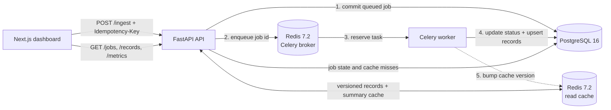

# Enterprise Ingestion & Retrieval Pipeline

A runnable five-service reference application for accepting validated data batches, processing them asynchronously, persisting durable job and record state, and serving bounded record views through a Redis-backed read cache.


## Business Problem Solved

Enterprise teams often need to accept bursty partner, CRM, or operational data without holding an HTTP request open while every record is written. A synchronous path couples client latency to database work, encourages unsafe retries, and makes it difficult for operators to see what happened after a request was accepted.

This project demonstrates a safer boundary:

- **Platform operators** get durable job states, dependency health, retry visibility, and explicit failures.
- **Integration developers** get strict request validation, idempotent submission, meaningful HTTP responses, and OpenAPI documentation.
- **Business and data users** get a responsive record explorer without placing every repeated read directly on PostgreSQL.

The potential ROI is architectural rather than a fabricated benchmark: fewer duplicate writes, faster incident diagnosis, and independent scaling of the HTTP and processing tiers. This repository does **not** claim a throughput, latency, cost-savings, or cache-hit target. Those outcomes require workload-specific load tests and production telemetry.

### System invariants

- A job is committed to PostgreSQL before dispatch is attempted.
- A successful asynchronous submission returns `202 Accepted`; a broker failure returns `503` and marks the durable job failed.
- Reusing an idempotency key with the same canonical request returns the original job; reusing it with different data returns `409 Conflict`.
- The worker upserts on `(source, external_id)`, so task retries do not create duplicate records.
- Job states are limited to `queued`, `processing`, `completed`, and `failed`.
- Record and metrics caches are invalidated after a committed ingestion and degrade to PostgreSQL if Redis reads fail.
- API record reads are bounded to 100 rows per request.

## Architecture



The write path is asynchronous after the durable job is created. The read path uses Redis only as an optimization: PostgreSQL remains the source of truth.

| Component | Responsibility |
|---|---|
| Next.js 16, React 19, TypeScript, Tailwind | Responsive dashboard, ingestion console, polling, job table, record explorer, and architecture view |
| FastAPI, Pydantic v2 | Validation, REST API, OpenAPI, CORS, dependency health, and error contracts |
| Celery | Background execution, bounded retries for transient dependency failures, and late acknowledgements |
| Redis 7.2 | Celery broker/result backend plus short-lived, versioned read caches |
| PostgreSQL 16, SQLAlchemy, Alembic | Durable jobs and records, uniqueness constraints, indexes, and schema migrations |
| Docker Compose | Local networking, health checks, persistent volumes, and five-service orchestration |

> The requested scaffold specified Next.js 14. It was upgraded to Next.js 16 because the latest 14.x release still produced critical production dependency advisories during implementation. The application still uses the requested App Router and TypeScript architecture.

## Run locally

Requirements: Docker with Compose v2 and free ports 3000 and 8000.

```bash
git clone https://github.com/jlstacks/enterprise-ingestion-fastapi-nextjs.git && \
cd enterprise-ingestion-fastapi-nextjs && \
cp .env.example .env && \
docker compose up --build --wait
```

That is the copy-paste development spin-up. Before any shared or exposed deployment, replace both example passwords in `.env` with generated secrets.

- Dashboard: <http://localhost:3000>
- OpenAPI UI: <http://localhost:8000/docs>
- Health: <http://localhost:8000/health>

Stop the stack without deleting persisted data:

```bash
docker compose down
```

Delete local PostgreSQL and Redis volumes only when you intentionally want a clean database:

```bash
docker compose down --volumes
```

### Environment variables

| Variable | Purpose | Example |
|---|---|---|
| `POSTGRES_USER` | Local database role | `ingestion` |
| `POSTGRES_PASSWORD` | PostgreSQL password; change outside disposable local use | `generated-secret` |
| `POSTGRES_DB` | Database name | `ingestion` |
| `REDIS_PASSWORD` | Redis authentication; change outside disposable local use | `generated-secret` |
| `CACHE_TTL_SECONDS` | Metrics and records cache lifetime | `20` |
| `API_PORT` | Loopback host port for FastAPI | `8000` |
| `FRONTEND_PORT` | Loopback host port for Next.js | `3000` |

Inside Compose, `DATABASE_URL`, `REDIS_URL`, `ALLOWED_ORIGINS`, and `API_INTERNAL_URL` are assembled from these values. PostgreSQL and Redis are not published to the host.

## API

| Method | Endpoint | Behavior |
|---|---|---|
| `GET` | `/health` | Reports API, database, Redis, and worker health |
| `POST` | `/ingest` | Validates and durably queues a batch; returns 202 |
| `GET` | `/jobs?limit=10` | Lists recent jobs |
| `GET` | `/jobs/{job_id}` | Returns one durable job state |
| `GET` | `/records?limit=12&offset=0&source=demo-crm` | Returns bounded, optionally source-filtered records |
| `GET` | `/metrics` | Returns live database counts by job state |

Submit a demonstration batch:

```bash
curl -i http://localhost:8000/ingest \
  -H 'Content-Type: application/json' \
  -H 'Idempotency-Key: demo-crm-batch-001' \
  --data '{
    "source": "demo-crm",
    "items": [
      {"external_id": "acct-001", "payload": {"account": "Northstar", "stage": "qualified"}},
      {"external_id": "acct-002", "payload": {"account": "Evergreen", "stage": "review"}}
    ]
  }'
```

Then poll the returned job and retrieve the records:

```bash
curl http://localhost:8000/jobs/JOB_ID
curl 'http://localhost:8000/records?source=demo-crm&limit=20'
```

Requests contain at most 100 items. `source` and `external_id` have bounded formats and lengths; extra fields are rejected.

## Development and testing

Backend tests and static checks run in the repository's Python 3.12 test image:

```bash
docker build --target test -t enterprise-ingestion-backend-test ./backend
docker run --rm enterprise-ingestion-backend-test pytest -q tests
docker run --rm enterprise-ingestion-backend-test ruff check --no-cache app tests migrations
```

Frontend checks:

```bash
cd frontend
npm ci
npm audit --omit=dev
npm run lint
npm run typecheck
npm run build
```

Running-stack integration check:

```bash
python3 backend/tests/integration_check.py
```

The integration check covers health, `202` acceptance, same-payload idempotent replay, conflicting-key rejection, malformed payload rejection, worker completion, persisted records, and a Redis cache hit. CI runs dependency audit, lint, type checks, production build, backend unit tests, Ruff, and Compose configuration validation.

Apply migrations manually when running the API outside its container:

```bash
cd backend
alembic upgrade head
```

The API container performs that migration step before Uvicorn starts.

## Implemented vs. planned

Implemented now:

- Strict Pydantic v2 ingestion validation and documented REST responses
- Durable PostgreSQL job ledger and record persistence
- Redis/Celery processing with transient retry handling
- Idempotent submission and conflict detection
- Database upserts that prevent duplicate record creation on retries
- Versioned Redis record cache and metrics cache with invalidation
- Responsive operational dashboard with polling and accessible controls
- Health checks, non-root application containers, read-only filesystems, persistent volumes, and loopback-only published ports
- Alembic migration and automated repository checks

Planned production controls, intentionally not claimed as implemented:

- Authentication and role-based authorization
- TLS termination and an ingress/reverse proxy
- Per-tenant rate limits and payload-size limits at the edge
- Dead-letter queue and operator-driven replay workflow
- OpenTelemetry traces, structured log aggregation, alerting, and SLOs
- Distributed scheduler/beat service if periodic reconciliation is required
- Multi-tenant row isolation and encryption-key management

## Known limitations

- This is a local reference deployment, not a hardened production topology.
- Redis carries both broker and cache traffic; production deployments should consider separate instances and independent policies.
- Caching is bounded by TTL and a global record-cache version. It is deliberately simple, not a substitute for query-specific cache governance.
- Idempotency is enforced per submitted request key; record upserts are globally unique on `(source, external_id)`.
- PostgreSQL and Redis do not form a single transaction. A production deployment should use an outbox/reconciliation process for a process crash between the database commit and broker publish.
- Worker state is polled rather than streamed. WebSockets or server-sent events are not implemented.
- No load benchmark is included. Capacity, latency, cache-hit ratio, and cost claims must be measured against a defined workload.

## Production hardening priorities

1. Put the API behind TLS, authentication, authorization, request-size enforcement, and tenant-aware rate limiting.
2. Move secrets to a managed secret store and rotate database/Redis credentials.
3. Separate broker and cache infrastructure; configure Redis ACLs, TLS, memory policies, and backups.
4. Add managed PostgreSQL backups, point-in-time recovery, connection pooling, and migration gates.
5. Add a transactional outbox/reconciler, dead-letter/replay tooling, queue-depth alerts, tracing, structured logs, and service-level objectives.
6. Run reproducible load and failure tests before making performance or delivery guarantees.

## License

[MIT](LICENSE)
